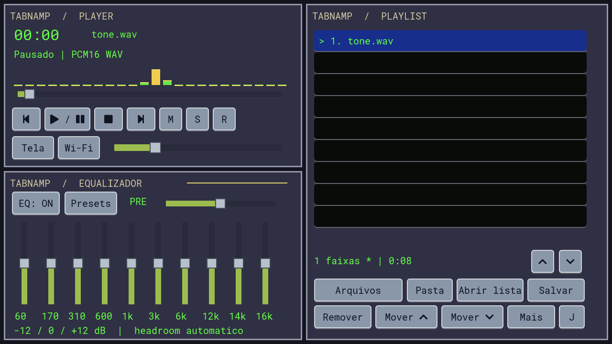

# Tabnamp

Player de áudio C++17 para **M5Stack Tab5**, ESP-IDF **5.4.4**, LVGL **9.3.0**, BSP **1.3.2** e esp_lvgl_port **2.9.0**. Aplicação independente; nenhuma dependência de launcher. Inclui simulador nativo **LVGL + SDL** que executa a mesma interface, controlador, persistência, parser de playlists e DSP do firmware.

O artefato de entrega é **`artifacts/tabnamp-ota.bin`**, uma imagem de aplicação para instalação pelo Launcher do Paludo/OTA, sem tabela de partições ou bootloader no pacote. Os relatórios físicos e limites de validação estão em `docs/STATUS.md`; a emulação não comprova funcionamento dos periféricos.

## Downloads

| Arquivo | Uso |
|---|---|
| [tabnamp-ota.bin](https://github.com/tpklge/Tabnamp/releases/latest/download/tabnamp-ota.bin) | Aplicação ESP32-P4 para o launcher/OTA; 3.026.096 bytes |
| [tabnamp-microsd.zip](https://github.com/tpklge/Tabnamp/releases/latest/download/tabnamp-microsd.zip) | Extraia na raiz do microSD: cria `tabnamp/` com configurações, fontes e presets |
| [tabnamp-completo.zip](https://github.com/tpklge/Tabnamp/releases/latest/download/tabnamp-completo.zip) | Firmware, padrões do microSD, instalador de arquivos e licenças |
| [tabnamp-testes-mp3.zip](https://github.com/tpklge/Tabnamp/releases/latest/download/tabnamp-testes-mp3.zip) | Apitos, batidas e teste estéreo sintéticos; copie para `tabnamp/music/testes/` |
| [tabnamp-ffmpeg-source.tar.gz](https://github.com/tpklge/Tabnamp/releases/latest/download/tabnamp-ffmpeg-source.tar.gz) | Fontes modificadas e configuração do FFmpeg usado neste firmware |
| [SHA256SUMS.txt](https://github.com/tpklge/Tabnamp/releases/latest/download/SHA256SUMS.txt) | Verificação dos arquivos publicados |

Os quatro primeiros arquivos também estão em [`artifacts/`](artifacts/), na branch `main`. Para instalar, prepare o microSD e envie o `.bin` como aplicativo pelo launcher, em um slot com pelo menos 3.026.096 bytes. A atualização mantém a tabela de partições e o bootloader existentes.

Versão testada no Tab5: ganho do codec/EQ corrigido, botões com cantos discretos e atualização do espectro restrita à sua área. A janela de reprodução do MP3 maior registrou intervalo máximo de 42 ms entre callbacks da interface e zero erros de saída. O usuário confirmou volume adequado e resposta ao toque melhor. Evidências resumidas em [`artifacts/validation.json`](artifacts/validation.json) e limites em [`docs/STATUS.md`](docs/STATUS.md).



## Implementado

- Fonte local pelo microSD, pendrive USB FAT e HTTP(S), saída PCM estéreo ES8388/I2S pelo BSP, tarefas separadas de controlador/decoder, saída e análise. Ring comprimido de 1 MiB, prefetch/gapless WAV PCM compatível, HLS AAC/ADTS/MPEG-TS e fila PCM limitada a 256 blocos de 512 frames, descarte por geração, buffering e reconexão de stream com backoff.
- WAV PCM16 mono/estéreo 44,1/48 kHz; integração de MP3, FLAC, AAC/ADTS, M4A e Ogg Vorbis/Opus com `esp_audio_codec` **2.5.0**. Esta versão evita a exigência de P4 revisão ≥3.0 do codec 2.6.
- **WMA Standard v1/v2 e ATRAC3/ATRAC3plus** ligados nativamente por um conjunto reduzido do **FFmpeg 7.1.1**: somente decoders selecionados e demuxers ASF/OMA/WAV, sem vídeo, encoders ou rede no FFmpeg do dispositivo. Os fixtures desses quatro codecs foram reproduzidos no P4; outros perfis e bitrates exigem validação própria. WMA Pro/Voice/Lossless e outros ATRAC não são anunciados.
- Play/pause, stop, anterior/próxima, volume com rampa, mute, shuffle com histórico, repeat, seek PCM, índice incremental de quadros MP3 CBR/VBR e seek por decodificação/descarte nos demais codecs Espressif locais. As buscas são canceláveis; o caminho sequencial pode ser lento. Busca de WMA/ATRAC usa o demuxer FFmpeg. Rádio é LIVE, sem seek.
- Metadados ID3v1/v2.3/v2.4 comuns, Latin-1, UTF-8/UTF-16, comentários FLAC/Ogg, limites de leitura; ASF/OMA através do demuxer. Inclui atoms M4A, campos estendidos, capas PNG/JPEG e cache limitado.
- Equalizador real de dez bandas estéreo, preamp, bypass, headroom pela resposta combinada das bandas, saturação na saída e transição por crossfade de um bloco. Curva gráfica, indicação de Nyquist e salvamento de presets/preamp; presets são carregados do JSON no SD. FFT de 1024 pontos/Hann, 24 barras logarítmicas, captura pós-EQ/pré-volume e análise fora da tarefa de saída.
- UI clássica com botões de cantos levemente arredondados, atualizações só quando há mudanças, três painéis, reflow real em 1280×720 e 720×1280, orientação automática pela IMU ou manual preservando reprodução, fonte externa com acentos e paleta do manifesto no SD.
- Navegador de arquivos, adição de pastas recursiva, URL, abertura/salvamento M3U/M3U8/PLS, remoção, reordenação, seleção múltipla, arraste, ordenação por título/artista/álbum e pesquisa. Até 10.000 caminhos em RAM, com somente 9 linhas LVGL, reduzidas a 6 em retrato. Indexação incremental com cache limitado de tags em disco; coleção de 5.000 entradas exercitada no simulador.
- Persistência com debounce, temporário + flush/fsync + backup/rename, validação de esquema e recuperação de configurações corrompidas. Sessão/fila gravadas juntas num checkpoint schema 2 com backup a cada 15 s; retorno pausado e volume limitado a 40% no boot. Nunca grava playlists sobre extensões de arquivos musicais.
- USB HID boot keyboard com reconexão, eventos de pressão/soltura, repetição controlada, atalhos no `keymap.json`, campos de texto protegidos contra atalhos e teclado virtual. Inclui descritores HID Consumer/multimídia e layouts US/ABNT2 com acentos.
- Wi-Fi pelo C6/ESP-Hosted SDIO slot 1, busca de redes, credenciais no SD, restauração de rede, SNTP e HTTPS com validação TLS. Não atualiza firmware do C6. microSD continua no slot 0 do BSP.
- Backlight desligado após **300 s sem entrada**, áudio independente, animações, FFT e invalidação visual suspensas. Primeiro contato/tecla de despertar, repetições e soltura são consumidos. Alvos físicos de latência/fps/continuidade não foram medidos.

## Build e gravação

```sh
./tools/build.sh set-target esp32p4
./tools/build.sh build size
```

ESP-IDF 5.4.4 deve estar em `$IDF_PATH` ou `~/esp/esp-idf`. O script usa o ambiente Python do SDK; neste computador prefere a instalação Python 3.9 existente. O primeiro build baixa o FFmpeg fixado por SHA-256 e compila apenas o subconjunto de codecs. Dependências do Component Manager estão fixadas em `dependencies.lock`; SDK/compilador vêm da instalação ESP-IDF. É um projeto ESP-IDF direto, sem `platformio.ini`.

Saídas de desenvolvimento: `build/tabnamp.bin`, ELF, map e arquivos auxiliares do SDK. A tabela local serve ao build e não determina o slot de execução. O aplicativo guarda dados no microSD e não exige partições NVS/SPIFFS próprias.

```sh
python3 tools/package_release.py
```

A entrega contém somente o binário de aplicação, checksum/SHA-256 verificados e um manifesto com tamanho e hash. **Envie `artifacts/tabnamp-ota.bin` como aplicativo ao Launcher do Paludo**. O launcher escolhe um slot com espaço suficiente. Não grave a tabela ou o bootloader gerados pelo SDK sobre o aparelho com launcher.

Para instalar a partir deste workspace com o launcher ativo:

```sh
~/.espressif/python_env/idf5.4_py3.9_env/bin/python tools/launcher_install.py --port /dev/cu.usbmodem12201
```

O script consulta o launcher pela serial e usa sua API HTTP local autenticada para enviar/instalar. Requer Wi-Fi conectado no launcher e `tab5_usb.py` do projeto vizinho (ajustável por `--launcher-tools`). Por padrão recusa planos que alterem o layout. Quando o launcher precisar alocar/redimensionar seu slot, use `--allow-launcher-allocation` após backup integral; a alteração fica a cargo do próprio launcher. Compara os aplicativos antes/depois e não usa esptool. A aplicação não depende desse script ou do código do launcher para executar.

## microSD, skin e uso

Cartão já formatado/montado; o instalador não formata, não apaga e não substitui arquivos existentes:

```sh
python3 tools/prepare_sd.py /Volumes/SEU_CARTAO
python3 tools/generate_tone.py /Volumes/SEU_CARTAO/tabnamp/music/teste.wav
```

A raiz física é `/sdcard/tabnamp`; músicas podem estar em outras pastas do cartão. Pendrives FAT são montados em `/usb`, sem formatação automática. No navegador **Arquivos**, use **SD** ou **USB** para selecionar a unidade e **+ Pasta** para adicionar recursivamente. Retirar o pendrive interrompe sua reprodução e libera os arquivos antes da desmontagem; músicas do SD continuam tocando. Os dados de configuração permanecem no microSD. **Arquivos** abre o navegador, **Pasta** permite adicionar recursivamente, **Abrir lista** substitui a playlist após confirmação se houver alterações. **Mais** contém URL, ordenação, limpeza e ajuda. Toque numa linha para selecionar e reproduzir; **Salvar** aceita somente `.m3u`/`.m3u8`. Presets: Flat, Rock, Pop, Jazz, Classical, Bass Boost e Voice; editar `/tabnamp/eq/presets.json` permite ajustar os perfis.

**Tela** abre orientação automática/manual, brilho, balance, saída alto-falante/fones, layout físico, visualizador e nova tentativa de montagem SD. Em **Wi-Fi**, solicite **Buscar redes** e reabra o diálogo para consultar o resultado; informe SSID/senha e conecte. A senha fica em `config/wifi.json` no cartão removível, não é registrada em logs. SNTP deve obter data válida para validar certificados TLS. O cartão não oferece proteção contra acesso físico.

Atalhos: Espaço play/pausa; Z/B anterior/próxima; X play; C pausa; V stop; M mute; S shuffle; R repeat; E foco no EQ; P foco na lista; setas volume ou navegação na lista; esquerda/direita ±5 s; Ctrl+O playlist; Ctrl+L URL; Ctrl+S salvar; Delete remover; Tab/Shift+Tab foco; Esc fechar. Há teclado virtual. O mapa é lido de `config/keymap.json` no boot. O layout físico US/ABNT2 é selecionado nas preferências.

Configuração consolidada em `config/settings.json`; `config/ui.json` carrega orientação/brilho e é atualizado junto às preferências. Persistência não usa NVS do aplicativo. Fontes binárias de 20/32 px e paleta vêm de `skins/classic`; há fonte mínima de recuperação na flash. Os JSONs `audio.json` e certos campos adicionais da especificação são modelos de migração, não outra autoridade sobre o estado atual.

As fontes externas são subconjuntos de **Roboto Mono** (SIL OFL; licença junto aos binários), com fallback dos símbolos da fonte LVGL. Para regenerar usando uma fonte licenciada e Node/npm:

```sh
./tools/build_assets.sh /caminho/para/fonte.ttf
```

O conversor `lv_font_conv` está fixado em 1.5.3 por `tools/assets/package-lock.json`. As imagens de referência não entram no firmware.

## Áudios sintéticos e controle pela serial

```sh
python3 tools/generate_test_audio.py artifacts/meus-testes
python3 tools/player_serial.py --port /dev/cu.usbmodem12201 status
python3 tools/player_serial.py --port /dev/cu.usbmodem12201 play /sdcard/tabnamp/music/testes-20261119/apitos.mp3
python3 tools/hardware_test.py --port /dev/cu.usbmodem12201 --seconds 120
python3 tools/hardware_ui_audio.py --port /dev/cu.usbmodem12201 --seconds 30
python3 tools/player_serial.py --port /dev/cu.usbmodem12201 band 5 -3
```

Use um Python com `pyserial` instalado (o ambiente ESP-IDF deste computador já inclui). O gerador usa ffmpeg e cria WAV/MP3 originais de apitos, batidas e alternância estéreo, em pico baixo, sem sobrescrever arquivos. O teste físico espera os arquivos no caminho mostrado e registra saída aceita pelo codec, PCM não nulo, posição, erros e memória. Ouvir o alto-falante/fones é uma confirmação separada. `player reboot` retorna ao boot normal do launcher; `browse /usb` seguido de `files` consulta o navegador sem touch.

## Simulador e testes

Dependências de desktop: CMake, compilador C/C++, pkg-config, SDL2 (ou SDL2-compat + SDL3), FFmpeg com headers/libs, curl, Python e ESP-IDF para a cópia fixada do cJSON. O ambiente validado é macOS arm64. Em outros sistemas, adaptar as dependências do linker do teste legado quando necessário.

```sh
./tools/emulator.sh                    # UI interativa, SD simulado em sdcard/tabnamp
./tools/emulator.sh test               # integração LVGL/SDL + servidor HTTP local
./tools/host-test.sh                   # núcleo com ASan/UBSan
./tools/test_all.sh                    # build + testes + 1h local e 30min de rádio acelerados
```

`test_all.sh` executa também o mesmo FFmpeg reduzido/alterado compilado para o computador e compara WMA/ATRAC3/ATRAC3plus com PCM de referência independente. WMA v1/v2 são sintéticos. Os fixtures ATRAC3 e ATRAC3plus são baixados do repositório de testes do FFmpeg, verificados por SHA-256 e mantidos no diretório de build ignorado e copiados ao SD do aparelho somente para o ensaio; não integram o pacote de distribuição. Primeiro uso requer internet para dependências e esses fixtures.

Resultados: `artifacts/test-report.json`, logs, `landscape.png` e `portrait.png`. O ensaio prolongado conta áudio efetivamente consumido pela saída simulada e exerce EQ, volume e rotação; o tempo é **acelerado**. A taxa de frames é medida separadamente por flushes completos do display de software durante um intervalo real de relógio. Os resultados do simulador não constituem validação de I2S/Wi-Fi/USB no Tab5. Os ensaios físicos separados estão em `docs/STATUS.md`. ASan/UBSan verificam o núcleo/ponte/UI; o FFmpeg reduzido do host é compilado com ASan. LeakSanitizer não é suportado pelo runtime deste macOS e está desativado.

## Recuperação e pendências

Configuração inválida recupera `.bak`; sem backup válido usa padrões. Falha de escrita informa erro e preserva o arquivo anterior quando possível. FAT não é transacional: remoção/queda de energia e recuperação física precisam de teste. Sem SD, a UI informa o problema; a montagem pode ser repetida pela UI e há tentativa periódica quando a raiz desaparece; o comportamento elétrico do hotplug requer teste físico. Sem som, comece pelo WAV sintético e logs BSP/ES8388. Sem Wi-Fi, confira configuração do C6/transporte e data antes de HTTPS; não regrave automaticamente o C6.

Veja `docs/STATUS.md`, `docs/CODEC_SUPPORT.md`, `docs/ARCHITECTURE.md` e `docs/PERFORMANCE.md` para limites exatos, licenças e validação física restante.
